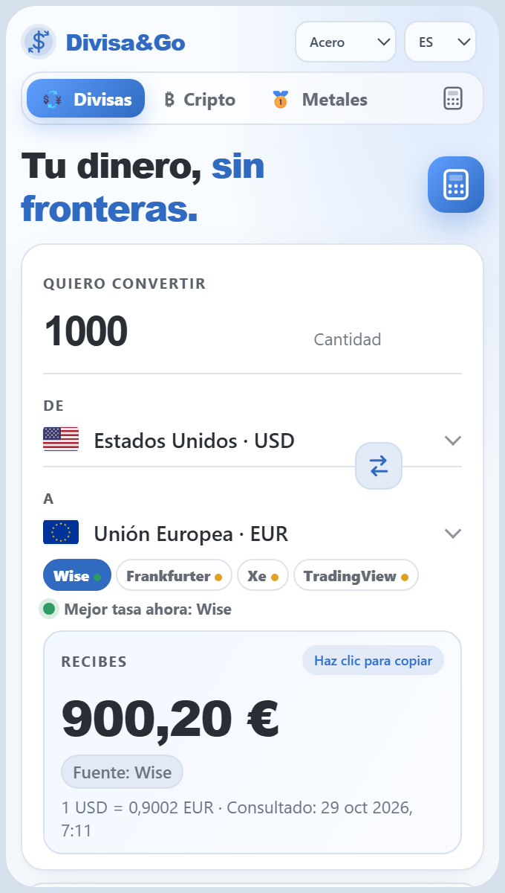
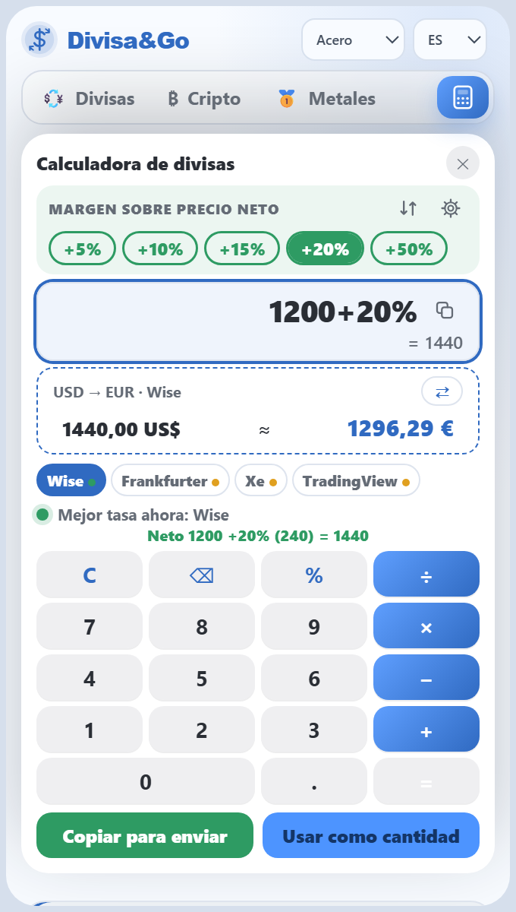
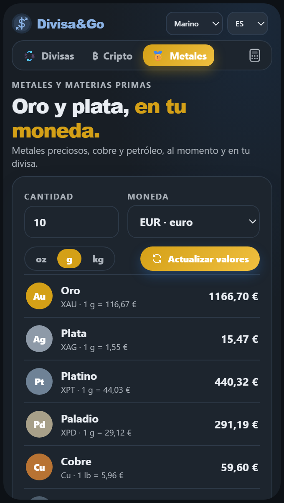

<div align="center">



<br>

**Convierte más de 150 divisas, calcula el precio final con tu margen y compara cuatro fuentes de tasas.**<br>
Gratis · Sin cuenta · Tus datos se quedan en tu equipo

<br>

<a href="https://github.com/dannymedinacoronel/DivisaGo-support/raw/main/downloads/Divisa-and-Go-Setup-1.0.0.exe"></a>
&nbsp;
<a href="https://divisaandgo.netlify.app/"></a>

<br>


**[Web](https://divisaandgo.netlify.app/)** &nbsp;·&nbsp; **[Soporte](https://divisaandgo.netlify.app/soporte.html)** &nbsp;·&nbsp; **[Privacidad](https://divisaandgo.netlify.app/soporte.html#privacidad)** &nbsp;·&nbsp; **[Licencia](https://divisaandgo.netlify.app/licencia.html)** &nbsp;·&nbsp; **[Vídeo](assets/demo-es.mp4)**

<br>

<table>
  <tr>
    <td align="center"><br><sub><b>Convierte</b></sub></td>
    <td align="center"><br><sub><b>Calcula tu margen</b></sub></td>
    <td align="center"><br><sub><b>Metales y cripto</b></sub></td>
  </tr>
</table>

</div>

<br>


## Qué hace

<table>
  <tr>
    <td width="50%" valign="top">

### Convierte
Más de 150 monedas con su bandera y su nombre en tu idioma. Elige de dónde sale la tasa: el cálculo, la calculadora y el gráfico usan esa fuente.

</td>
    <td width="50%" valign="top">

### Calcula tu margen
Escribe el precio neto, toca **+20 %**, **+50 %** o tu porcentaje y copia solo el precio final con su conversión. Y al revés: con el precio final te dice qué margen te queda.

</td>
  </tr>
  <tr>
    <td valign="top">

### Compara fuentes
Wise, Frankfurter, Xe y TradingView, con un semáforo que te dice cuál da más a tu favor. Los valores atípicos se descartan y las cotizaciones antiguas se marcan.

</td>
    <td valign="top">

### Cripto, metales y materias primas
Oro, plata, platino, paladio, cobre, petróleo y las criptomonedas principales, en tu moneda y por gramo, onza o kilo.

</td>
  </tr>
  <tr>
    <td valign="top">

### Hecha a tu gusto
Cinco temas (Acero, Marino, Noche, Día y Rosa), seis idiomas, tutorial guiado y preguntas frecuentes dentro de la app.

</td>
    <td valign="top">

### Privada y a salvo
Sin cuenta, sin analítica. Copia automática diaria dentro del navegador, con restauración en un clic y exportación a archivo.

</td>
  </tr>
</table>


## Cuatro fuentes, una respuesta

| Fuente | Qué aporta |
|---|---|
| **Wise** · por defecto | Tasa de mercado casi en tiempo real e histórico propio en el gráfico. |
| **Frankfurter** | Referencia diaria de bancos centrales para 159 monedas. |
| **Xe** | Tasa media de mercado, como segunda opinión. |
| **TradingView** | Cotización de mercado y futuros para metales y materias primas. |

> Los tipos de referencia son diarios y el resto de cotizaciones son indicativas: **no son tasas en tiempo real ni una oferta de cambio o inversión.** Las criptomonedas son muy volátiles.


## Instalar

### Extensión para Chrome
Funciona como **popup**, **ventana flotante** o **panel lateral anclado a la derecha**, y puedes pasar de uno a otro sin perder nada.

> La extensión está **en revisión** en la Chrome Web Store. En cuanto se publique, el enlace estará aquí y en la [web](https://divisaandgo.netlify.app/).

### App para Windows
1. **[Descarga `Divisa-and-Go-Setup-1.0.0.exe`](https://github.com/dannymedinacoronel/DivisaGo-support/raw/main/downloads/Divisa-and-Go-Setup-1.0.0.exe)** (99 MB).
2. Ábrelo y sigue el asistente. Puedes elegir la carpeta y crear el acceso directo.
3. Abre **Divisa&Go** desde el escritorio o el menú Inicio. La chincheta la mantiene siempre visible.

<details>
<summary><b>Windows muestra un aviso al instalar, ¿es seguro?</b></summary>

<br>

El instalador aún no tiene firma digital de pago, así que SmartScreen puede decir *«Windows protegió su PC»*. Pulsa **Más información → Ejecutar de todas formas**.

Para comprobar que el archivo es el original, compara su huella **SHA-256**:

```
d9cf2656a3cbbd0b3e890c59e7b44fee7adddb8db97d1aa43215592153ca9961
```

En PowerShell: `Get-FileHash .\Divisa-and-Go-Setup-1.0.0.exe -Algorithm SHA256`

</details>


## Privacidad

- **Sin cuenta ni seguimiento propio.** Favoritos, márgenes y ajustes viven en tu navegador o en tu equipo.
- **Solo el par de monedas.** A las fuentes se les pide el par o el producto; nunca el importe que escribes ni tus márgenes.
- **Copias en tu equipo.** Una al día y otra antes de cada actualización (las últimas 7), restaurables en un clic.

Más detalle en la [política de privacidad](https://divisaandgo.netlify.app/soporte.html#privacidad).

## Licencia

**Divisa&Go es software propietario, gratuito de usar.** Puedes usarlo en tu vida personal y en tu trabajo, también en empresas y organizaciones, **mientras lo usen hasta 50 personas**.

| | |
|---|---|
| **Personas y equipos** | Gratis. Uso personal y profesional, en organizaciones de hasta 50 personas. |
| **Más de 50 personas** | **Licencia corporativa obligatoria.** Escribe a [empresademkor@gmail.com](mailto:empresademkor@gmail.com?subject=Licencia%20corporativa%20Divisa%26Go). |

No es software libre ni de código abierto: no puedes copiarlo, modificarlo, redistribuirlo, venderlo ni publicarlo en otros sitios sin autorización por escrito. Texto completo en [`LICENSE`](LICENSE) o en la [página de licencia](https://divisaandgo.netlify.app/licencia.html).

## Versiones

| Versión | Fecha | Novedades |
|---|---|---|
| **Extensión de Chrome 1.6.0** | 29/10/2026 | Calculadora de márgenes, «al revés», copiar para enviar, semáforo de tasas con Wise por defecto, metales y materias primas, cinco temas, copias automáticas y tutorial guiado. |
| App de Windows 1.0.0 | 27/10/2026 | Primera versión: instalador, siempre visible, datos guardados en tu equipo. |
| Extensión de Chrome 1.5.0 | 27/10/2026 | Calculadora, sección Cripto, panel lateral y seis idiomas. |

Los instaladores y paquetes están en [`downloads/`](downloads/), con sus sumas SHA-256.

## Ayuda y contacto

[Soporte y preguntas frecuentes](https://divisaandgo.netlify.app/soporte.html) &nbsp;·&nbsp; [empresademkor@gmail.com](mailto:empresademkor@gmail.com?subject=Soporte%20Divisa%26Go) &nbsp;·&nbsp; También disponible: [FullPage Saver](https://chromewebstore.google.com/detail/igjphghlkmidddmnmlmdnhnepehpoena), mi otra extensión.


<details>
<summary><b>In English</b></summary>

<br>

**Divisa&Go** is a free currency converter and margin calculator for Chrome and Windows. It converts 150+ currencies, adds your margin to a net price (and works backwards from a final price), compares four rate sources with a traffic light, and shows crypto, metals and commodity prices in your currency. No account, no analytics; your data stays on your device.

- **Download for Windows:** [Divisa-and-Go-Setup-1.0.0.exe](https://github.com/dannymedinacoronel/DivisaGo-support/raw/main/downloads/Divisa-and-Go-Setup-1.0.0.exe)
- **Chrome extension:** under review on the Chrome Web Store.
- **License:** proprietary and free to use, personally or at work, **for organizations of up to 50 people**. A corporate license is mandatory above that — write to [empresademkor@gmail.com](mailto:empresademkor@gmail.com?subject=Corporate%20license%20Divisa%26Go).
- **Website:** [divisaandgo.netlify.app](https://divisaandgo.netlify.app/) · [Demo video](assets/demo-en.mp4)

Reference rates are daily and other quotes are indicative: they are not real-time rates nor an exchange or investment offer.

</details>

<div align="center">

<br>

<sub>Desarrollado por <b>Demkor Consultants</b> · Desarrollador principal: <b>Danny Medina Coronel</b><br>© 2026 Demkor Consultants. Todos los derechos reservados.</sub>

</div>
